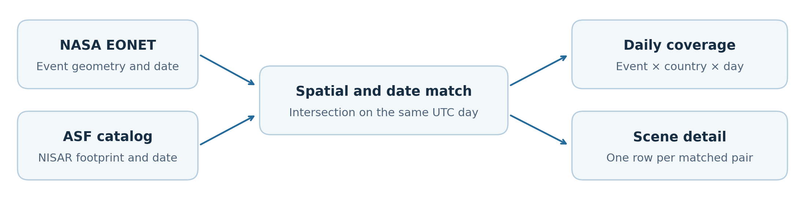
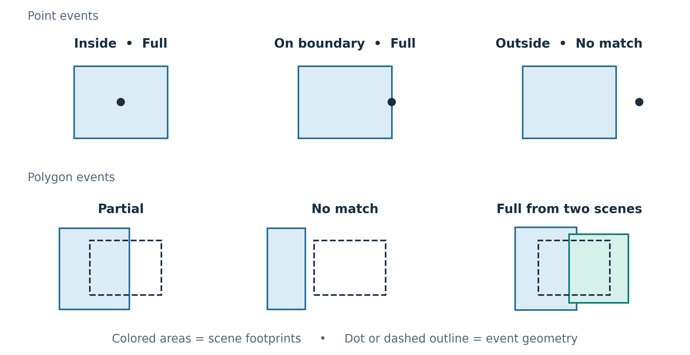

# NISAR Event Coverage Explorer

A NASA Space Apps Challenge project that matches natural events from NASA EONET with NISAR radar scene footprints from the Alaska Satellite Facility (ASF). A Power BI dashboard and a web portal show which events have scene coverage on the same UTC day and which scenes are available for review.

## What you can explore

- **Events** by country, hazard category, and UTC date.
- **Daily coverage** for each event and country, with full, partial, and no-match results.
- **Matched scenes** with acquisition timestamps, scene identifiers, and preview thumbnails where available.

## Data pipeline

The Python notebook extracts EONET events and NISAR GCOV catalog records, prepares their geometries, and matches scenes to events. ASF records can be loaded into BigQuery in daily partitions from smaller acquisition windows, so the full history does not have to fit in notebook memory. BigQuery stores the results for Power BI and the portal. Google Sheets supplies hazard guidance and emergency contact reference data.

| BigQuery table | Purpose |
| --- | --- |
| `db_eonet_raw` | Source event records from EONET. |
| `db_eonet` | Prepared EONET records with country assignments, geometries, and map coordinates. |
| `db_asf_raw` | NISAR GCOV catalog metadata and source GeoJSON. |
| `db_eonet_monitor` | One row per event, country, and UTC day, including events without a match. |
| `db_asf_incident` | Scene-level matches by event, country, and UTC day. |
| `vw_db_nasa_public` | Physical BigQuery table that exposes selected fields and English coverage labels to the portal. |
| `dim_country`, `dim_date`, `dim_hazard` | Reference dimensions for reporting. |
| `bridge_event_hazard` | Links EONET events to their hazard categories. |
| `db_hazard_guidance`, `db_emergency_contacts` | Hazard guidance and country-level emergency contacts. |

## How coverage works

A scene matches when its footprint intersects the event geometry and the scene acquisition and event observation fall on the same UTC date. A point on the footprint boundary counts as covered. For a polygon, an intersection can qualify as a match even when it only touches the boundary.

| Daily status | Rule |
| --- | --- |
| **Full** | The union of matched scene footprints covers the entire event geometry. |
| **Partial** | At least one footprint intersects the event geometry, but their union leaves some of it uncovered. |
| **None** | No scene in the analyzed ASF extraction matches that event on that UTC day. |

Each scene also has its own coverage result. Two scenes can each be partial and together cover the entire event geometry. For unique events or scenes across multiple rows, count distinct event IDs or scene IDs. Daily counts are calculated per event, country, and UTC date.

## Run the data pipeline

1. Open the project ETL notebook in Google Colab and run its package setup cells. The core libraries are pandas, GeoPandas, Shapely, `asf_search`, and the BigQuery Python client.
2. Set the analysis dates and review the ASF extraction window. Run the EONET extraction and preparation cells.
3. For an ASF historical load, configure the BigQuery connection before running the daily batch cells. Authenticate with a Google account that can write to your destination dataset and set `PROJETO_GCP`, `DATASET_BQ`, and `LOCAL_BQ` for that dataset.
4. Set `PUBLICAR_BIGQUERY = False` in the BigQuery configuration cell for preview where the notebook supports it. Enable publishing for the actual load. Review `ATUALIZAR_TABELAS` before replacing an existing table.
5. Run the ASF preparation, matching, and table validation cells. Use `db_eonet_monitor` and `db_asf_incident` for the Power BI coverage and scene views, and `vw_db_nasa_public` for the portal.

## Interpretation

Coverage depends on the ASF records included in the extraction. The status describes the spatial relationship between cataloged footprints and the event geometry. Scene thumbnails support visual inspection. Quantifying changes in the radar images requires a separate before-and-after analysis.

## Data sources

- [NASA Earth Observatory Natural Event Tracker (EONET)](https://eonet.gsfc.nasa.gov/)
- [Alaska Satellite Facility (ASF) Search](https://search.asf.alaska.edu/)
- [Natural Earth](https://www.naturalearthdata.com/)

- ## Dashboard and documentation

- [Power BI Dashboard and Metrics](powerbi/README.md)
- [Technical Documentation and Data Dictionary (PDF)](nisar-event-coverage-data-dictionary.pdf)
