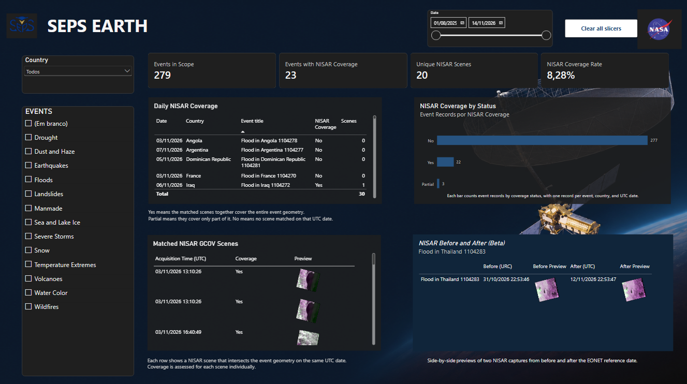

# SEPS EARTH Power BI Dashboard

https://www.seps.earth/sepsearth

**SEPS EARTH** is a Power BI dashboard that connects natural events cataloged by NASA EONET with radar scenes from the NISAR mission. It shows which events had NISAR coverage on the same UTC date, how much of the event geometry the matched scenes covered, and which scene previews are available for review.

**Filters.** Users can select a **country**, a **date range**, and one or more **event types**, such as floods, wildfires, or severe storms. In the screenshot, **Floods** is selected across all countries. The dashboard shows **12 distinct events**, **3 distinct events with NISAR coverage**, and **3 unique matched scenes**. The **23.53% coverage rate** represents **4 of 17 event records** with full or partial coverage. Each record represents one event, country, and UTC date, so an event can contribute more than one record.

**Coverage and scene details.** The daily table and bar chart show three statuses. **Yes** means the matched scenes together cover the entire event geometry. **Partial** means the scenes intersect it without fully covering it. **No** means no scene in the analyzed ASF data matched the event on that UTC date. The **Matched NISAR GCOV Scenes** table shows the acquisition time, coverage, and preview for each individual scene.

**Before and After (Beta).** A fixed example displays two NISAR previews side by side for a flood in Thailand. The scenes were acquired on **31 October** and **12 November 2026**, before and after the **6 November EONET reference date**. The previews support visual inspection of the two captures.

**Data sources.** **NASA EONET** provides event IDs, names, categories, observation dates, and geometries. The **Alaska Satellite Facility (ASF)** catalog provides **NISAR GCOV** scene footprints, acquisition timestamps, product identifiers, polarization metadata, and preview links. **Natural Earth** country boundaries support geographic assignment. The processed records and comparison pairs are prepared in **BigQuery** and displayed in **Power BI**.

Which natural events did NISAR observe, and how much of each event area did the matched scenes cover?

SEPS EARTH combines NASA EONET event records with NISAR radar scenes from the Alaska Satellite Facility (ASF). Use the **Country**, **Date**, and **Events** filters to explore coverage and inspect scene previews.

<!-- After uploading dashboard.png to this folder, uncomment the next line.

-->

## Dashboard metrics

The screenshot shows **Floods** across all countries.

| Metric | What it measures | Floods example |
| --- | --- | ---: |
| Events in Scope | Distinct EONET events in the selected filters | 12 |
| Events with NISAR Coverage | Distinct events with at least one full or partial match | 3 |
| Unique NISAR Scenes | Distinct ASF scenes associated with the selected events | 3 |
| NISAR Coverage Rate | Share of event records with full or partial coverage | 23.53% (4 of 17) |

The coverage chart counts one record per **event, country, and UTC date**. The same event can appear in more than one record.

## How to read the coverage

| Status | Meaning |
| --- | --- |
| **Yes** | The matched scenes together cover the entire event geometry. |
| **Partial** | The matched scenes intersect the event geometry without fully covering it. |
| **No** | No scene in the analyzed ASF data matched the event on that UTC date. |

**Matched NISAR GCOV Scenes** shows the capture time, coverage, and preview for each individual scene.

**Before and After (Beta)** shows a fixed example from the Thailand flood. The two previews were captured on **31 October** and **12 November 2026**, around the **5 November 2026** EONET reference date.

## Data sources

- **NASA EONET** provides event names, categories, observation dates, and geometries.
- **ASF** provides NISAR GCOV scene footprints, acquisition times, polarization metadata, and preview links.
- **Natural Earth** provides boundaries for assigning countries to event geometries.

BigQuery prepares the event, coverage, and scene data for Power BI. [See the project overview and data pipeline](../README.md).
